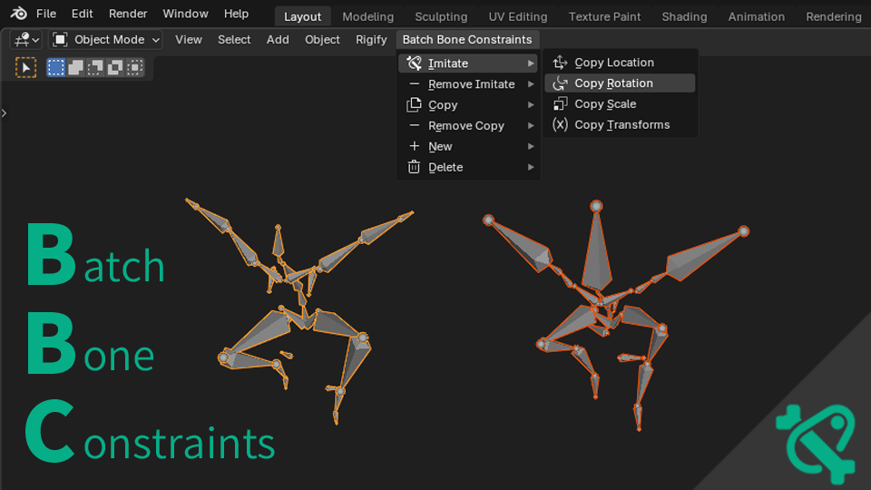

# Batch Bone Constraints

Batch bone constraints to the selected multiple armatures.

## Features

- **Six Operation Modes**:
  - **Imitate**: Add constraints targeting bones with same names in active object (Object mode)
  - **Remove Imitate**: Remove constraints targeting bones with same names in active object (Object mode)
  - **Copy**: Copy constraints from bones with same names in active armature (Object mode)
  - **Remove Copy**: Remove constraints matching those in active armature (Object mode)
  - **New**: Add new constraints to all bones (Object mode) or selected bones (Pose mode)
  - **Delete**: Remove constraints by type, including invalid constraints (Object & Pose modes)

## Quick Start

### Access Menu
- Go to **3D Viewport > Header > Batch Bone Constraints**
- Menu appears when armatures are active or selected in Object or Pose mode

### Basic Usage
1. **Object Mode**: Select target armature(s) → Choose operation and constraint type
2. **Pose Mode**: Select bones in active armature → Choose New or Delete operation
3. **Imitate Mode**: Select active armature/mesh + other armatures → Choose constraint type

## Supported Constraints

### Imitate Modes (4 types)
- Copy Location, Copy Rotation, Copy Scale, Copy Transforms

### All Other Modes
- All Blender bone constraint types, including invalid constraint detection

## Installation

1. Open Blender > Edit > Preferences > Extensions
2. Search for "Batch Bone Constraints"
3. Click Install

## Requirements

- Blender 4.2+
- Multiple armatures with matching bone names (for Imitate/Copy modes)

## License

This addon is released under the GPL-3.0-or-later license.